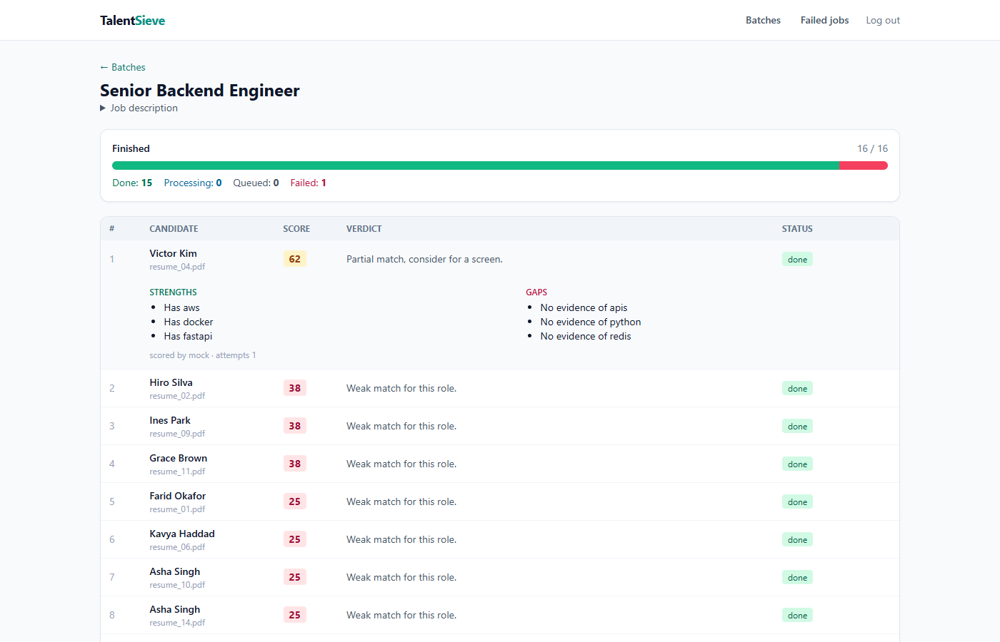
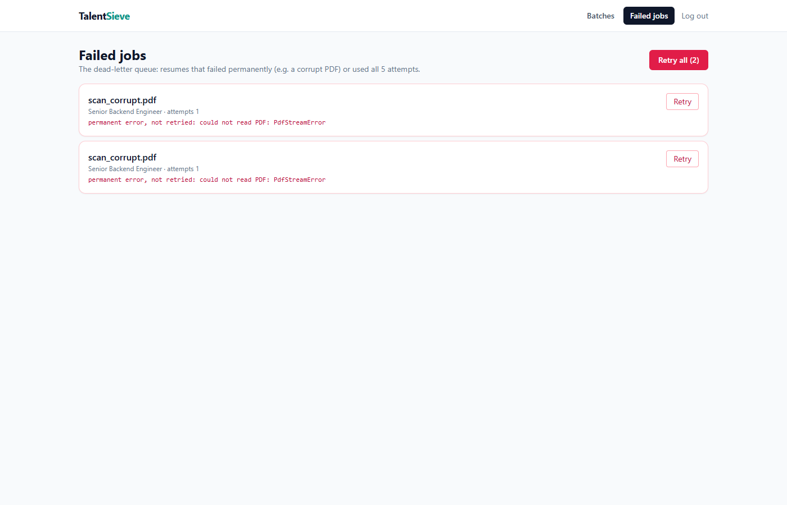
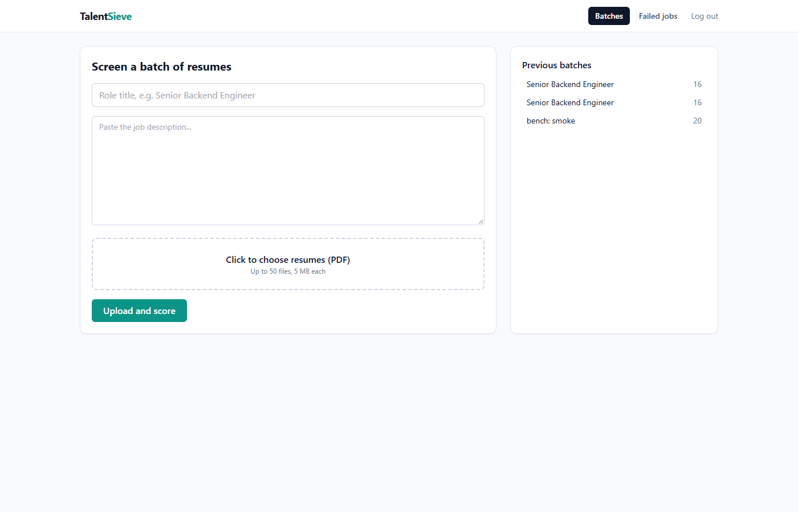
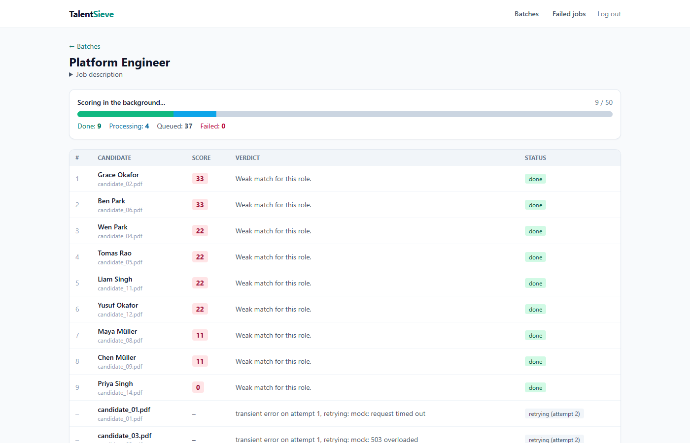
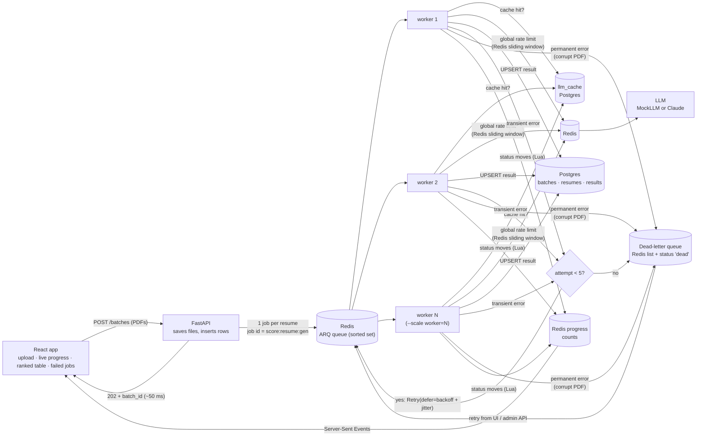

# TalentSieve

A recruiter pastes a job description and uploads up to 50 resumes (PDF).
Each one is scored 0-100 by an LLM with 3 strengths, 3 gaps and a one-line
verdict, and shown in a live, ranked table. Built to show one thing in
depth: **background job processing with a message queue**.

## What this project demonstrates

- **Non-blocking API:** the upload answers in **~50 ms** with a batch id. One job per resume goes onto a Redis queue (ARQ); the API never calls the LLM.
- **Horizontal scaling:** `docker compose up --scale worker=4` cuts 50 resumes from **75 s to 19.5 s** (linear), and to **5.8 s** with 4 concurrent jobs per worker.
- **Explicit failure handling:** transient errors (timeouts, 429, 5xx, bad JSON) retry with exponential backoff and full jitter, up to 5 attempts. Permanent errors (corrupt PDF, no text) skip retries and go straight to a **dead-letter queue** with the reason. A UI and API let you retry DLQ jobs. With **30% of LLM calls failing, 50 of 50 resumes still succeeded.**
- **At-least-once delivery made safe:**
  - a unique constraint plus `UPSERT` means a job that runs twice stores one result
  - progress counters move through a Lua script that can't double-count
  - deterministic job ids
- **Proven crash safety:** a test `SIGKILL`s a real worker mid-job. The job stays queued, and a second worker picks it up after ARQ's in-progress lock expires. Result: 1 result, attempt 2. The mechanism is documented from ARQ's own source.
- **Global LLM rate limit** across all workers: a sliding window in Redis, using Redis's own clock. 16 free slots, 30 calls/min limit: **63 s for 50**, exactly on contract.
- **Cost control:** LLM answers are cached by `hash(prompt version, provider, resume, job description)`. A re-upload makes zero LLM calls and uses zero rate-limit slots.
- **Live progress over Server-Sent Events**; a MockLLM (latency plus configurable failure rate) so everything runs and is testable without an API key; an Anthropic provider when you add one.
- **47 tests** against real Postgres, Redis and ARQ workers, plus `DECISIONS.md` (why a queue, why ARQ over Celery, at-least-once vs idempotency, when to move to RabbitMQ or Kafka) and `INTERVIEW.md`.

## Results

| Scenario (50 resumes, 1.0 s per LLM call) | Total time | Throughput |
|---|---|---|
| 1 worker | 75.2 s | 40 / min |
| 2 workers | 37.7 s | 80 / min |
| 4 workers | **19.5 s** | 154 / min |
| 4 workers × 4 concurrent jobs | **5.8 s** | **520 / min** |
| 30% LLM failure rate (4 × 4) | 15.7 s | **100% success** after retries (81 LLM calls) |
| Global limit 30 calls/min (4 × 4) | 63.1 s | held to the limit |

Details: [docs/BENCHMARKS.md](docs/BENCHMARKS.md).


## Screenshots

| Ranked results with live progress (SSE) | Failed jobs (dead-letter queue) with retry | Upload |
|---|---|---|
|  |  |  |

| Live progress while 50 resumes are scored: done, processing, queued, and jobs retrying after transient LLM errors |
|---|
|  |

## Architecture



## Run it

Requirements: Docker with Compose.

```bash
cp .env.example .env        # optional; leave ANTHROPIC_API_KEY empty to use MockLLM
docker compose up --build
```

| What | URL |
|---|---|
| App (log in as `recruiter@talentsieve.dev` / `recruit123`) | http://localhost:5174 |
| API docs | http://localhost:8004/docs |

Generate 50 sample resumes (plus 2 corrupt ones, to watch the dead-letter queue), then upload them in the app:

```bash
docker compose exec api python -m scripts.generate_resumes --count 50 --corrupt 2 --out /app/sample_resumes
docker compose cp api:/app/sample_resumes ./sample_resumes
```

### Scale the workers

```bash
docker compose up -d --scale worker=4
```

### Use a real LLM

Put `ANTHROPIC_API_KEY=...` in `.env` (never commit it) and restart. The provider is chosen automatically; `ANTHROPIC_MODEL` and `ANTHROPIC_EFFORT` are configurable.

### Watch a crash being recovered

```bash
docker compose up -d --scale worker=2
# upload a batch, then while it runs:
docker kill $(docker compose ps -q worker | head -1)
# the jobs that worker held are picked up by the other one after job_timeout + 10 s
```

## Tests

```bash
docker compose exec api pytest -q
```

Real Postgres, real Redis, real ARQ workers (in-process, and as separate OS processes for the crash test):
- retry until success; dead-letter after 5 attempts; permanent errors never retried
- DLQ list, retry one, retry all
- idempotency: crash after write before ack, duplicate delivery, concurrent duplicates, duplicate enqueue
- `SIGKILL` crash recovery
- global rate limit across 4 connections
- cache hits skip the LLM and the limiter
- SSE stream
- strict output validation; provider error policy

## Docs

- [docs/DECISIONS.md](docs/DECISIONS.md): why a queue, ARQ vs Celery, retries, DLQ, at-least-once and idempotency, ARQ crash semantics, rate limiting, caching, when to move to RabbitMQ or Kafka
- [docs/BENCHMARKS.md](docs/BENCHMARKS.md): scaling, failures, rate limit, crash recovery
- [docs/INTERVIEW.md](docs/INTERVIEW.md): 15 interview questions answered with this codebase

## Layout

```
backend/app/
  worker.py      ARQ worker: retry vs DLQ decision, backoff
  jobs.py        one job: load, parse, cache/rate-limit/LLM, UPSERT, status
  errors.py      TransientError vs PermanentError (the explicit split)
  dlq.py         dead-letter queue
  progress.py    crash-safe progress counters (Lua)
  ratelimit.py   global sliding-window limiter (Lua, Redis clock)
  cache.py       LLM result cache
  llm/           base (strict JSON + Pydantic), mock, anthropic
  routers/       auth, batches (+ SSE), admin DLQ
backend/scripts/generate_resumes.py   sample PDFs
backend/benchmarks/                   measure.py + run_benchmarks.sh + results
frontend/                             React + Vite + Tailwind
```
